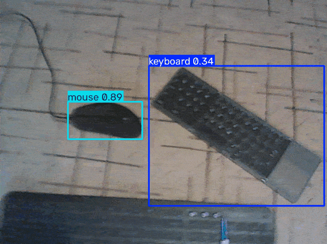

# Desk Objects Detector

Детектор предметов на рабочем столе (клавиатура, мышь, ручка) на YOLOv8,
обученный на кастомном датасете.



## Результаты

Финальная модель (YOLOv8n, дообучена на расширенном датасете, 257 изображений):

| Класс     | Precision | Recall | mAP@50 |
|-----------|-----------|--------|--------|
| keyboard  | 0.97      | 0.97   | 0.97   |
| mouse     | 0.93      | 0.98   | 0.99   |
| pen       | 0.92      | 1.00   | 0.99   |

Общий mAP@50-95: **0.945**.

## История проекта

1. Скачал готовый датасет с Roboflow (~130 изображений рабочего стола).
2. Обучил YOLOv8n с нуля — mAP@50 ≈ 0.90, но модель проваливалась на
   сложных сценах: предметы в руке, под непривычным углом (уверенность
   падала до 0.55–0.62).
3. Собрал 71 собственное фото с веб-камеры — новые ракурсы, разное
   освещение, предметы в руке. Разметил в Roboflow.
4. Дообучил модель на объединённом датасете — провалы ушли,
   recall по ручкам вырос до 1.00.

## Структура

- `batch_process.py` — батч-обработка папки изображений + CSV-отчёт
  с координатами рамок.
- `live_demo.py` — детекция с веб-камеры в реальном времени.
- `collect_frames.py` — сбор кадров с камеры для разметки (пробел — кадр, q — выход).
- `download_dataset.py` — скачивание датасета с Roboflow.
- `runs/detect/train-2/weights/best.pt` — финальные веса модели.

## Быстрый старт

```bash
pip install -r requirements.txt

# Детекция с веб-камеры
python live_demo.py

# Батч-обработка изображений
python batch_process.py
